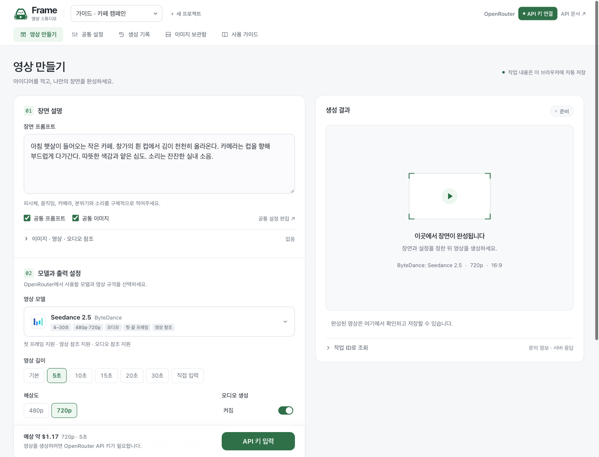
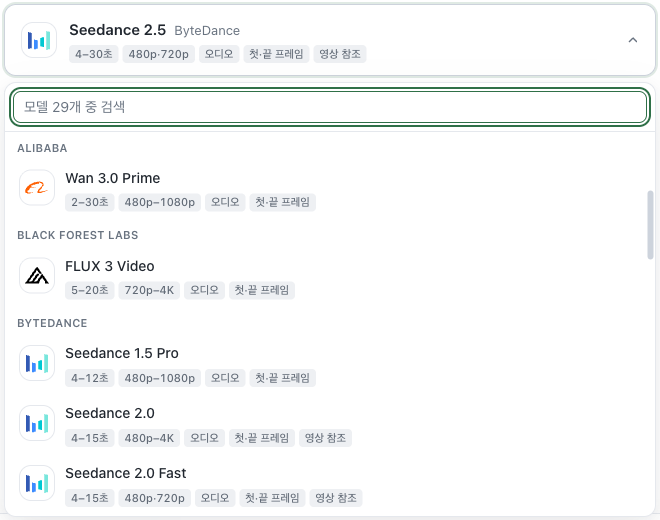
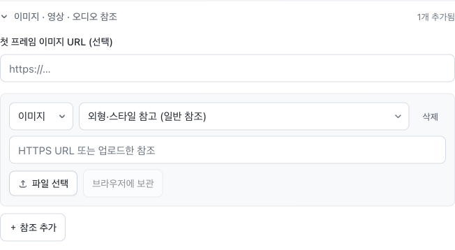
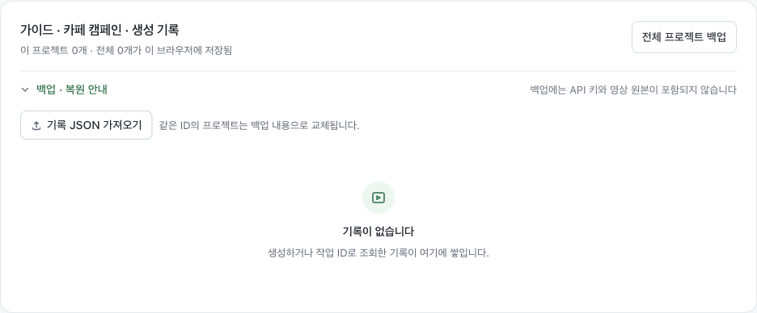

# Frame 사용 가이드

OpenRouter 연결부터 첫 영상 생성, 이미지 참고, 결과 저장까지 순서대로 따라 해보세요. 이 문서는 **Frame의 OpenRouter 연결 화면**을 기준으로 설명합니다. 개발 지식이나 별도의 서버 설치는 필요하지 않습니다.

> 처음이라면 **2. OpenRouter 연결하기 → 3. 첫 영상 만들기** 순서로 진행하세요. 참조 이미지는 첫 영상을 만든 뒤 추가해도 됩니다.

## 1. Frame과 화면 이해하기

Frame은 장면을 글로 설명하고 AI 모델을 선택해 짧은 영상을 만드는 작업 공간입니다. Frame에서 요청을 작성하면 OpenRouter를 통해 모델이 영상을 생성합니다. 생성 비용은 **입력한 API 키의 OpenRouter 계정**에 청구됩니다.

| 용어 | 뜻 | 예시 |
| --- | --- | --- |
| OpenRouter | 여러 AI 모델을 하나의 계정과 키로 이용하는 서비스 | 모델을 바꿔도 같은 OpenRouter 키 사용 |
| API 키 | Frame이 내 계정으로 요청을 보낼 수 있게 하는 비밀 문자열 | OpenRouter에서 발급받아 Frame에 입력 |
| 모델 | 실제로 영상을 만드는 AI | 모델마다 영상 길이·해상도·입력 방식이 다름 |
| 프롬프트 | 만들고 싶은 장면을 설명하는 글 | “창가의 커피잔에서 김이 올라온다” |
| 참조 | 생성할 때 참고시키는 이미지·영상·소리 | 제품 사진, 인물 이미지 |
| 프로젝트 | 공통 스타일과 생성 기록을 묶는 작업 단위 | “겨울 캠페인”, “제품 소개 영상” |

OpenRouter의 연결·과금 구조는 [공식 소개](https://openrouter.ai/collections/video-models)에서도 확인할 수 있습니다.



*그림 1. API 연결 전 예시 프로젝트로 촬영한 실제 Frame 화면. 이미지를 누르면 큰 화면으로 볼 수 있습니다. 모델 목록과 예상 비용은 이용 시점에 따라 달라집니다.*

- **상단 프로젝트 선택:** 작업할 프로젝트를 바꿉니다. 옆의 **새 프로젝트**로 별도 작업 공간을 만듭니다.
- **영상 만들기:** 장면 설명과 모델·출력 설정을 입력합니다. 왼쪽 하단에서 예상 비용을 확인하고 생성합니다.
- **오른쪽 생성 결과:** 진행 상태와 완성된 영상이 표시됩니다. 처음에는 빈 미리보기가 보이는 것이 정상입니다.
- **공통 설정:** 여러 장면에 반복해서 적용할 프롬프트와 이미지를 관리합니다.
- **생성 기록:** 이전 요청과 결과를 다시 확인합니다.
- **이미지 보관함:** 브라우저에 보관한 참조 이미지 원본을 재사용합니다.

Frame의 프로젝트는 **현재 브라우저 안의 작업 공간**입니다. 프로젝트 이름이 같아도 다른 팀원이나 다른 기기의 브라우저와 자동 공유되지 않습니다.

## 2. OpenRouter 연결하기

### 준비할 것

- 사용할 팀의 OpenRouter 계정 또는 해당 계정에서 발급한 API 키
- 영상 생성에 사용할 크레딧 잔액과 키의 사용 한도
- 작업을 계속할 브라우저와 기기

**크레딧**은 API 사용 비용을 결제하는 잔액이고, **키의 사용 한도**는 그 키로 사용할 수 있는 금액의 제한입니다. 한도를 높이는 것만으로 잔액이 충전되지는 않습니다. 계정 잔액과 키 한도를 각각 확인하세요.

### 키 발급과 입력

1. [OpenRouter](https://openrouter.ai/)에 로그인합니다. 계정의 결제·크레딧 설정에서 사용할 잔액을 준비합니다.
2. [API 키 설정](https://openrouter.ai/settings/keys)을 엽니다. 새 키에 팀과 용도를 알 수 있는 이름을 붙입니다. 예: `콘텐츠팀 Frame`.
3. 사용할 금액에 맞게 키의 한도를 지정하고 발급된 키를 복사합니다. 키 생성과 한도에 대한 설명은 [OpenRouter 인증 문서](https://openrouter.ai/docs/api/reference/authentication)를 참고하세요.
4. Frame 오른쪽 위의 **API 키 연결**을 누릅니다.
5. 연결 서비스에서 **OpenRouter**를 선택합니다. **OpenRouter API Key** 입력창에 키를 붙여넣고 **확인**을 누릅니다.
6. 상단 버튼이 **API 키 저장됨**으로 바뀌면 영상 만들기로 돌아갑니다.

> **‘API 키 저장됨’은 입력한 키를 저장했다는 뜻입니다.** 키의 유효성이나 크레딧 잔액까지 확인했다는 뜻은 아닙니다. 실제 요청에서 인증 오류가 나면 복사한 키와 OpenRouter 계정의 상태를 확인하세요.

키는 입력하는 동안 이 브라우저에 자동 저장됩니다. 새로고침하거나 다시 방문해도 재입력할 필요가 없습니다. 다른 기기·브라우저·사이트 주소에서는 다시 입력해야 합니다.

### 키 변경과 삭제

상단 **API 키 저장됨**을 눌러 값을 바꾸면 새 키가 저장됩니다. **저장된 키 지우기**는 Frame에 저장한 연결 키를 지우며, 프로젝트와 생성 기록은 지우지 않습니다. OpenRouter에서 키 자체를 폐기하려면 OpenRouter의 API 키 설정에서 삭제해야 합니다.

키는 비밀번호처럼 다루세요. 팀 채팅·화면 캡처·공개 문서에 그대로 넣지 마세요. 공용 기기에서는 사용 후 Frame에 저장된 키를 지우세요.

## 3. 첫 영상 만들기

먼저 **참조 이미지 없이 글만으로 한 장면**을 만들어보겠습니다.

### ① 장면 설명하기

**영상 만들기 → 장면 프롬프트**에 아래 예시를 붙여넣습니다. 입력창 아래 **예시로 시작** 버튼을 눌러 시작할 수도 있습니다. 예시 버튼은 입력창이 비어 있을 때 표시됩니다.

> 아침 햇살이 들어오는 작은 카페. 창가의 흰 컵에서 김이 천천히 올라온다. 카메라는 컵을 향해 부드럽게 다가간다. 따뜻한 색감과 얕은 심도. 소리는 잔잔한 실내 소음.

좋은 출발점은 **피사체 + 움직임 + 카메라 + 분위기**입니다. 한 번에 여러 사건을 넣기보다 짧은 한 장면에 집중하면 결과를 비교하기 쉽습니다.

| 요소 | 질문 | 예시 |
| --- | --- | --- |
| 피사체 | 무엇을 보여주나요? | 흰 컵, 향수병, 창가에 앉은 사람 |
| 움직임 | 무엇이 어떻게 움직이나요? | 김이 천천히 올라온다, 고개를 돌린다 |
| 카메라 | 어느 시선으로 촬영하나요? | 고정 카메라, 천천히 다가가기, 옆으로 이동 |
| 분위기 | 빛과 색감은 어떤가요? | 따뜻한 자연광, 차가운 야간 조명 |
| 소리 | 어떤 소리가 필요한가요? | 잔잔한 실내 소음, 바람 소리 |

소리에 관한 설명은 **오디오 생성이 가능한 모델**에서 오디오를 켰을 때 사용하세요.

### ② 모델과 규격 고르기

**영상 모델**에서 사용할 모델을 선택합니다. 처음에는 해당 모델이 지원하는 짧은 길이와 낮은 해상도로 결과를 확인해보세요. 예를 들어 **5초·720p·16:9**가 표시되는 모델이라면 이 조합으로 시작할 수 있습니다. 표시되지 않는 옵션은 그 모델에서 선택할 수 없습니다.

기존 프로젝트에서 시작했다면 **공통 프롬프트·공통 이미지**가 켜져 있는지도 확인하세요. 공통 설정이 이번 장면에 필요하지 않으면 해당 체크를 해제합니다.

### ③ 비용 확인하고 생성하기

1. 왼쪽 하단의 **예상 비용**을 확인합니다. **예상 비용 상세**를 펼치면 계산에 사용한 길이·해상도 등을 볼 수 있습니다.
2. 경고나 누락된 입력이 있으면 먼저 수정합니다.
3. **영상 생성**을 한 번 누릅니다. 버튼이 접수 또는 업로드 상태로 바뀝니다.
4. 오른쪽 결과 영역에 진행 상태가 나타납니다. Frame이 자동으로 상태를 확인하므로 반복해서 생성 버튼을 누를 필요가 없습니다.
5. **생성 완료**가 되면 영상 결과를 재생합니다. **파일 열기**로 원본을 열어 브라우저의 다운로드 기능으로 저장합니다.

**사전 견적 불가**는 무료라는 뜻이 아닙니다. 실제 비용은 모델·길이·해상도·오디오·참조 입력 등에 따라 달라질 수 있습니다. 최종 사용량은 생성 기록과 [OpenRouter Activity](https://openrouter.ai/activity)에서 확인하세요.

## 4. 모델과 생성 설정 알아보기



*그림 2. 모델 이름 왼쪽의 로고는 모델 공급사를 나타냅니다. 목록 아래의 태그로 지원 범위를 확인하세요.*

모델 선택창에는 공급사별로 모델이 묶여 있습니다. 목록이 길면 위쪽 검색창에서 모델 이름이나 공급사 이름을 검색할 수 있습니다. 키보드로는 방향키로 이동하고 **Enter**로 선택하며 **Esc**로 닫습니다.

| 설정 | 무엇을 바꾸나요? | 선택할 때 참고할 점 |
| --- | --- | --- |
| 영상 길이 | 결과 영상의 재생 시간 | **기본**은 모델의 기본 길이입니다. 직접 입력이 보이면 안내된 범위 안의 정수를 입력합니다. |
| 해상도 | 영상의 크기와 세부 묘사 | 모델마다 지원하는 해상도가 다릅니다. 높은 해상도는 비용도 달라질 수 있습니다. |
| 화면 비율 | 가로·세로 형태 | **16:9**는 가로 영상, **9:16**은 세로 영상, **1:1**은 정사각형입니다. |
| 오디오 생성 | 영상과 함께 소리를 만들지 여부 | 지원하지 않는 모델에서는 선택할 수 없습니다. |
| 시드 | 생성에 사용하는 난수의 시작값 | 지원 모델의 추가 옵션에 표시됩니다. 같은 값을 사용해도 같은 영상이 보장되지는 않습니다. |
| 워터마크 | 모델이 제공하는 표시의 사용 여부 | 지원하는 모델에만 나타납니다. |

모델을 바꾸면 사용 가능한 설정도 바뀝니다. 생성 전에 길이·해상도·비율·오디오와 예상 비용을 다시 확인하세요. 오른쪽 빈 미리보기의 프레임은 선택한 비율을 보여주는 안내이며, 실제 생성된 영상이 아닙니다.

**첫·끝 프레임** 태그는 시작·종료 이미지를 입력으로 지정할 수 있다는 뜻입니다. 결과 영상에서 마지막 프레임을 자동으로 추출해준다는 뜻은 아닙니다. 현재 Frame의 OpenRouter 연결에서는 자동 마지막 프레임 추출과 이어 만들기 기능을 제공하지 않습니다.

지원 모델과 옵션은 바뀔 수 있습니다. Frame은 OpenRouter의 모델 목록을 불러와 선택지를 표시합니다. 전체 지원 범위는 [OpenRouter 영상 생성 문서](https://openrouter.ai/docs/guides/overview/multimodal/video-generation)를 참고하세요.

## 5. 이미지·영상·오디오 참고하기

참조 자료는 AI에게 “어떤 외형이나 스타일을 참고할지” 알려주는 입력입니다. 프롬프트에는 그 자료가 **어떻게 움직일지**를 함께 설명하세요.



*그림 3. 참조를 추가한 화면. 파일을 선택하는 것과 브라우저에 보관하는 것은 별도 단계입니다.*

### 내 컴퓨터의 이미지 사용하기

1. 장면 설명 아래 **이미지 · 영상 · 오디오 참조**를 펼칩니다.
2. **＋ 참조 추가**를 누릅니다.
3. 참조 종류를 **이미지**로 두고, 아래 표를 참고해 **참조 역할**을 고릅니다.
4. **파일 선택**으로 이미지를 고릅니다. OpenRouter용 이미지는 파일당 **10 MiB 이하**를 사용하세요.
5. **브라우저에 보관**을 누르고 **보관 완료** 안내를 확인합니다.
6. 이미지를 어떻게 사용할지 장면 프롬프트에 적고 영상을 생성합니다.

보관한 이미지는 현재 브라우저의 **이미지 보관함**에도 나타납니다. 이 단계는 OpenRouter에 영상을 요청하는 단계가 아닙니다. 이미지 데이터는 **영상 생성 요청 시** OpenRouter로 전송됩니다. 파일을 선택만 하고 보관하지 않았다면 새로고침 후 다시 선택해야 합니다.

| 참조 역할 | 사용할 때 | 주의할 점 |
| --- | --- | --- |
| 외형·스타일 참고 (일반 참조) | 인물·제품·색감·배경을 참고시키고 싶을 때 | 원본과 똑같은 모습이나 배치가 보장되지는 않습니다. |
| 영상 시작 화면 (첫 프레임) | 특정 이미지에서 영상이 시작되게 할 때 | 선택한 모델이 첫 프레임 입력을 지원해야 합니다. |
| 영상 끝 화면 (마지막 프레임) | 특정 이미지로 장면이 끝나게 할 때 | 마지막 프레임 지원 모델에서 첫 프레임과 함께 사용합니다. |

> 현재 Frame에서는 **첫·마지막 프레임 지정과 일반 참조를 한 요청에 섞을 수 없습니다.** 첫 프레임을 지정했는데 입력 충돌이 나오면 일반 참조를 제거하고, 프로젝트의 **공통 이미지** 적용도 확인하세요. 첫 프레임 URL 입력창과 참조 목록에 첫 프레임을 중복 지정하지 마세요.

### 인터넷 주소로 자료 사용하기

이미지의 **HTTPS URL**을 참조 URL에 넣을 수도 있습니다. 로그인해야 볼 수 있는 공유 페이지보다 OpenRouter가 직접 접근할 수 있는 파일 주소를 사용하세요.

영상·오디오는 해당 입력을 지원하는 모델에서만 참조 종류로 선택할 수 있습니다. **현재 Frame의 OpenRouter 화면에서는 영상·오디오 파일을 직접 업로드하지 않고 HTTPS URL로 입력합니다.** 선택할 수 없는 종류는 해당 모델에서 지원하지 않는 입력입니다.

### 모델별 인물 참조 정책과 오류

**이미지 참조 지원과 인물 이미지 허용은 다릅니다.** 같은 이미지라도 모델에 따라 생성되거나 거절될 수 있습니다. 인물 참조가 거절되면 그 용도를 허용하는 다른 모델을 선택할 수 있습니다. 아래는 공식 문서에서 확인한 주요 제한이며, 모든 모델의 정책을 나열한 목록은 아닙니다.

**모델 선택** 목록과 선택된 모델에 **실사 얼굴 참조 제한** 또는 **인물 참조 조건 확인** 표시가 나타납니다. 해당 모델을 고르면 선택 상자 아래에 한 줄 안내와 **자세히 보기** 링크가 표시됩니다. 링크를 누르면 이 문서에서 정책을 확인할 수 있습니다. 안내 표시는 모델 선택이나 텍스트만으로 생성하는 기능을 막지는 않습니다.

*정책 확인일: 2026년 11월 10일. 공급사 문서 기준이며, OpenRouter의 연결 공급사·모델 버전·계정 조건에 따라 적용 방식과 오류 문구가 달라질 수 있습니다.*

| 모델 | 확인된 인물 관련 제한 | 오류가 났을 때 |
| --- | --- | --- |
| **Seedance 2.5** (`bytedance/seedance-2.5`) | BytePlus는 실제 얼굴이 포함된 참조 이미지·영상의 직접 입력을 제한합니다. [공식 인물 자산 안내](https://docs.byteplus.com/en/docs/modelark/seedance-portrait-asset-guide) | Frame에서 **HTTP 400**과 `InputImageSensitiveContentDetected.PrivacyInformation`이 발생한 사례가 확인됐습니다. 인물 참조 용도를 허용하는 다른 모델을 선택하거나 공급사가 지원하는 인물 자산 등록 경로를 확인하세요. |
| **Seedance 2.0 / Fast / Mini** (`bytedance/seedance-2.0`, `bytedance/seedance-2.0-fast`, `bytedance/seedance-2.0-mini`) | BytePlus는 2.0 계열에도 같은 직접 입력 제한을 명시합니다. [계열별 지원 조건](https://docs.byteplus.com/en/docs/byteplus_las/video_gen_enhanced) | 2.5에서 인물 제한이 났다면 2.0·Fast·Mini로 바꾸는 것만으로 해결된다고 기대하기 어렵습니다. 실제 오류 코드는 서버 응답을 확인하세요. |
| **Veo 계열** (예: Veo 3.1) | Google은 아동·유명인 등 인물 범주와 설정·사용 권한에 따른 제한을 안내합니다. 모든 인물 이미지가 일괄 금지되는 정책과는 구분해야 합니다. [공식 인물·콘텐츠 심사 안내](https://docs.cloud.google.com/gemini-enterprise-agent-platform/models/video/responsible-ai-and-usage-guidelines) | 인물 관련 콘텐츠 심사로 거절될 수 있습니다. Google 문서의 `Child`, `Celebrity` 같은 사유와 실제 서버 메시지를 확인하세요. Google 직접 API의 허용 설정을 Frame에서도 변경할 수 있다는 뜻은 아닙니다. |

표에 없는 모델을 **제한 없음**으로 해석하지 마세요. 다른 모델에서 생성에 성공했더라도 모든 인물·입력 조합이 허용된다는 의미는 아닙니다. 사용할 모델의 정책과 요청 결과를 함께 확인하세요.

**Seedance 오류 예시**

```text
HTTP 400
InputImageSensitiveContentDetected.PrivacyInformation
The request failed because the input image 'content[2]' may contain real person.
```

이 메시지는 공급사가 해당 입력을 실제 인물 관련 자료로 판단했다는 뜻입니다. 실제 인물인지, 오탐인지까지 이 메시지만으로 확정할 수는 없습니다. 길이·해상도나 URL만 바꿔 같은 이미지를 다시 보내는 것으로 해결되지 않습니다. 다른 모델의 인물 제한이 반드시 같은 코드나 HTTP 상태로 표시되는 것은 아닙니다.

**오류가 나면 이렇게 진행하세요**

1. 결과 영역의 오류 문구와 **서버 응답 보기**에서 사유를 확인합니다. **HTTP 400만으로 인물 제한이라고 단정하지 마세요.** 지원하지 않는 옵션·참조 조합도 400을 반환할 수 있습니다.
2. 인물 정책에 따른 거절이라면, **모델 선택**에서 해당 인물 참조 용도를 허용하는 다른 모델을 고릅니다. 이미지 입력과 필요한 참조 역할을 지원하는지도 확인하세요.
3. 모델을 바꾼 뒤 **참조 역할·개수, 공통 이미지, 길이·해상도·비율, 예상 비용**을 다시 확인하고 생성합니다. 새 생성 요청에는 선택한 모델의 요금이 적용됩니다.
4. 인물이 없는 이미지에서 같은 오류가 나오는 등 사유가 맞지 않으면 **문의용 정보 복사**로 진단 정보를 모아 OpenRouter 지원에 문의합니다. 접수 여부가 불확실한 오류라면 새 요청 전에 Activity부터 확인하세요.

**이미지 보관과 인물 자산 등록의 차이**

브라우저의 **이미지 보관함**에 저장하는 것은 공급사의 **인물 자산 등록·인증**과 다릅니다. 현재 Frame의 OpenRouter 연결에는 인물 자산 등록·인증 기능이 연결되어 있지 않습니다. BytePlus는 승인된 실인물 자산, 사전 제공 디지털 캐릭터, 조건을 만족하는 동일 계정의 생성 결과 재사용을 안내하지만, 이 경로가 OpenRouter에서도 같은 방식으로 제공된다는 뜻은 아닙니다. [BytePlus 인물 자산 안내](https://docs.byteplus.com/en/docs/modelark/seedance-portrait-asset-guide)

### 보관한 이미지 다시 쓰기

**이미지 보관함**에서 이미지를 찾아 **장면에 추가** 또는 **공통 이미지로** 추가합니다. 장면으로 돌아와 역할과 프롬프트를 확인하세요. 같은 이미지로 여러 장면을 만들 때 파일을 매번 선택할 필요가 없습니다.

## 6. 프로젝트와 공통 스타일 관리하기

여러 장면을 같은 인물·제품·스타일로 만들 때 프로젝트와 공통 설정을 사용합니다.

1. 상단의 **새 프로젝트**를 누르고 작업 이름을 입력합니다. 예: `겨울 카페 캠페인`.
2. **공통 설정**에서 반복될 특징을 **공통 프롬프트**에 적습니다.
3. 필요하면 공통 이미지를 추가하고 브라우저에 보관합니다.
4. **영상 만들기**로 돌아와 이번 장면의 움직임만 장면 프롬프트에 적습니다.
5. **공통 프롬프트·공통 이미지** 체크가 켜져 있으면 공통 설정도 요청에 포함됩니다.

예를 들어 공통 프롬프트에는 “따뜻한 필름 색감, 같은 흰 도자기 컵, 부드러운 자연광”을 적고, 첫 장면에는 “컵으로 천천히 다가간다”, 다음 장면에는 “손이 컵을 들어 올린다”를 적을 수 있습니다. 같은 공통 설정이 인물·제품의 완전한 일치를 보장하지는 않습니다.

작성 중인 장면과 생성 옵션은 **프로젝트별로 자동 저장**됩니다. 다른 프로젝트로 이동했다 돌아오거나 새로고침해도 이어서 작성할 수 있습니다. 그 장면에서만 공통 스타일을 빼려면 체크를 해제하세요. 프로젝트의 공통 설정 자체를 삭제할 필요는 없습니다.

## 7. 결과 확인과 생성 기록

### 완성된 영상 저장하기

오른쪽 **생성 결과**에서 재생할 수 있는 결과를 선택합니다. **파일 열기**로 원본을 열고 기기에 다운로드하세요. 브라우저의 생성 기록에는 요청과 결과 정보가 남지만, **영상 원본을 영구 보관하는 것은 아닙니다.** 필요한 결과는 파일이 제공되는 동안 저장하세요.

### 이전 장면 다시 작업하기

**생성 기록**에서 원하는 작업을 찾습니다.

- **설정 불러오기:** 당시 프롬프트·모델·옵션을 작성 화면으로 가져옵니다. 생성 버튼을 누르기 전에는 새 요청을 보내지 않습니다. 공통 설정의 중복 적용을 막기 위해 공통 프롬프트·공통 이미지 적용은 꺼집니다.
- **결과 / 상태 조회:** 기존 작업의 상태와 결과를 다시 확인합니다. 새 영상을 만드는 요청이 아닙니다.
- **기록 삭제:** 브라우저의 기록을 삭제합니다. OpenRouter에서 진행 중인 작업을 취소하지 않습니다.

### 새로고침하거나 창을 닫았다면

이미 접수된 생성은 OpenRouter에서 계속 진행됩니다. Frame을 다시 열면 저장된 키로 대기·생성 중인 작업을 다시 조회합니다. 새로고침한다고 같은 생성 요청을 자동으로 다시 보내지는 않습니다. 브라우저를 닫은 동안 Frame이 완료를 알리거나 영상을 자동 다운로드하지는 않습니다.

자동 조회는 10~30초 간격으로 진행하며 최대 20분 후 멈춥니다. 조회가 멈췄다고 생성 실패가 확정된 것은 아닙니다. 생성 기록에서 다시 조회하거나, 결과 영역의 **작업 ID로 조회**에 접수된 작업 ID를 입력하세요. **자동 조회 중지**도 영상 생성 자체를 취소하는 기능은 아닙니다.

## 8. 자동 저장과 백업

**자동 저장**은 현재 브라우저에서 작업을 이어가는 기능이고, **백업**은 별도 파일로 내보내는 기능입니다. 다른 컴퓨터로 옮기거나 사이트 데이터를 지우기 전에는 백업이 필요합니다.

| 정보 | 이 브라우저에 자동 저장 | 전체 프로젝트 백업에 포함 |
| --- | --- | --- |
| API 키 | 예 | 아니요. 새 기기에서 직접 입력 |
| 작성 중인 장면·생성 옵션 | 예, 프로젝트별 저장 | 아니요. 필요한 내용은 별도로 복사 |
| 프로젝트 이름·공통 설정·생성 기록 | 예 | 예 |
| 브라우저에 보관을 완료한 이미지 원본 | 예 | 아니요. 이미지 원본 백업을 별도로 사용 |
| 선택만 하고 보관하지 않은 파일 | 아니요 | 아니요 |
| 생성 영상 원본 | 아니요 | 아니요. 원본을 직접 다운로드 |



*그림 4. 생성 기록에서 프로젝트 백업을 내려받고 기록 JSON을 가져올 수 있습니다. 참조 이미지 원본은 이미지 보관함에서 별도로 백업합니다.*

### 다른 기기로 옮기는 순서

1. **생성 기록 → 전체 프로젝트 백업**으로 프로젝트와 기록 JSON을 내려받습니다.
2. **이미지 보관함 → 원본 백업 · 복원 → 이미지 원본 백업**으로 참조 이미지 원본을 별도로 내보냅니다.
3. 작성 중이지만 아직 생성하지 않은 프롬프트는 복사해둡니다. **개발자용 · 요청 설정 JSON → 설정 JSON 저장**으로 요청 설정도 따로 보관할 수 있습니다. 이 요청 JSON을 자동으로 가져오는 기능은 없습니다.
4. 필요한 영상은 **파일 열기**에서 원본을 내려받습니다.
5. 새 기기의 Frame에서 **생성 기록 → 백업 · 복원 안내 → 기록 JSON 가져오기**로 프로젝트를 복원합니다.
6. **이미지 보관함 → 원본 백업 · 복원 → 이미지 백업 복원**으로 이미지 원본을 복원합니다.
7. **API 키 연결**에서 기존 작업을 만든 계정의 OpenRouter 키를 입력합니다.

기록을 가져오면 기존 기록과 합쳐집니다. 같은 ID의 프로젝트 공통 설정은 백업 내용으로 바뀌므로 가져오기 전에 현재 작업도 백업해두세요. 이미지 복원도 같은 ID의 원본을 교체합니다.

> 저장 범위는 **같은 사이트 주소 + 같은 브라우저 프로필**입니다. 브라우저의 사이트 데이터를 삭제하면 저장한 정보도 삭제됩니다. 비공개 창은 창을 닫을 때 데이터가 사라질 수 있습니다. 다른 팀원에게는 필요한 백업 파일을 전달해야 하며, API 키는 백업에 포함되지 않습니다.

## 9. 문제가 생겼을 때

| 보이는 상황 | 먼저 할 일 |
| --- | --- |
| API 키가 필요하다는 안내 | 상단 API 키 연결에서 OpenRouter 키를 입력합니다. |
| 인증 오류 / 401 | 키를 다시 복사하고 OpenRouter에서 키가 삭제·만료되지 않았는지 확인합니다. |
| 크레딧·한도 오류 / 402 | OpenRouter 잔액과 해당 키의 사용 한도를 각각 확인합니다. |
| 권한·정책·한도 오류 / 403 | 오류 안내를 읽고 계정·키의 권한과 팀 정책을 확인합니다. 필요한 경우 OpenRouter 계정 관리자에게 문의하세요. |
| 요청 제한 / 429 | 잠시 기다린 뒤 상태를 확인합니다. 이미 접수된 작업을 새로 생성하지 않도록 기록을 먼저 확인합니다. |
| 모델 목록을 불러오지 못함 | 네트워크를 확인하고 **모델 목록 다시 불러오기**를 누릅니다. 저장된 모델을 확인하지 못하면 설정을 유지한 채 생성 버튼이 잠길 수 있습니다. |
| 지원하지 않는 옵션 / 400 | 모델을 확인하고 길이·해상도·참조 조합을 다시 선택합니다. |
| 인물 이미지 제한 / `InputImageSensitiveContentDetected.PrivacyInformation` | Seedance 공급사가 실제 인물 관련 입력으로 판단해 거절했습니다. **5절의 모델별 인물 참조 정책과 오류**를 확인하고, 해당 용도를 허용하는 다른 모델을 선택하세요. |
| 다른 모델의 인물·콘텐츠 심사 오류 | 모델마다 정책과 오류 코드가 다릅니다. 서버 응답의 구체적인 사유를 확인하고 **5절의 모델별 인물 참조 정책과 오류**에 따라 대응하세요. |
| 접수 확인 필요 | **다시 생성하기 전에 OpenRouter Activity를 확인합니다.** 통신이 끊겨 응답을 못 받았더라도 요청은 이미 접수됐을 수 있습니다. |
| 결과 링크가 열리지 않음 | 결과 / 상태 조회 또는 링크 갱신으로 다시 확인합니다. 원본이 더 이상 제공되지 않으면 복구하지 못할 수 있습니다. |
| 브라우저 저장 실패 | 사이트 저장 권한과 남은 용량을 확인합니다. 새로고침 전에 입력 내용을 복사하고 기록을 백업합니다. |

요청 접수 여부와 실제 사용 내역은 [OpenRouter Activity](https://openrouter.ai/activity), 서비스 장애는 [OpenRouter 상태 페이지](https://status.openrouter.ai/)에서 확인하세요. 인증·잔액·요청 제한 오류의 의미는 [공식 오류 안내](https://openrouter.ai/docs/api/reference/errors-and-debugging)를 참고할 수 있습니다.

문의를 남길 때는 결과 영역의 **작업 ID로 조회 → 문의용 정보 복사**를 사용하세요. 작업 ID·상태·모델 등 진단에 필요한 정보가 포함되며, API 키와 프롬프트 원문·외부 URL은 제외됩니다. 내용을 확인한 뒤 담당자에게 전달하세요.

**다시 생성**은 새 요청이며 비용이 다시 발생할 수 있습니다. 이미 요청이 접수됐는지 불확실하면 상태와 활동 기록을 먼저 확인하는 것이 좋습니다.
